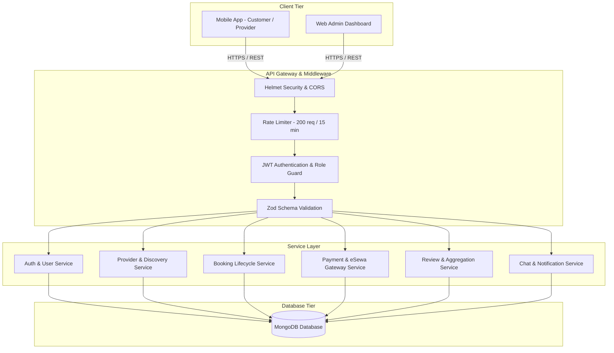

# SewaSathi — System Architecture Document
## Engineering Specification & Component Design

---

## 1. Architectural Philosophy

SewaSathi follows a **modular, layered architecture** adhering to the **Separation of Concerns (SoC)** principle. The system is split cleanly into three main tiers:

1. **Client Tier:** Mobile application (React Native / Expo) and Administrative Dashboard (Web).
2. **Application / API Tier:** Stateless Express.js micro-monolith providing RESTful JSON endpoints.
3. **Data Persistence Tier:** MongoDB document database managing collections with schema constraints and geospatial indexes.



---

## 2. Backend Layered Architecture

To maintain maintainability and testability for an enterprise-ready computing project, the backend is organized into distinct logical layers:

```
backend/src/
├── config/             # Environment validation (Zod) & DB connection
├── controllers/        # HTTP protocol adapters (req, res, next)
├── database/           # Seeders and migration utilities
├── middleware/         # Auth, validation, error handling, rate limiting
├── models/             # Mongoose schemas, hooks, methods, and indexes
├── routes/             # Route declarations, middleware chains, versions
├── services/           # Pure business logic and domain workflows
├── utils/              # Token helpers, crypto utilities, response builders
└── validators/         # Declarative Zod request schemas
```

### 2.1 The Request-Response Lifecycle
1. **Network Entry:** An inbound HTTP request hits Express.
2. **Security & Sanitization:** `helmet` sets HTTP security headers; `cors` verifies allowed origins; `express.json` parses payload up to 10MB; `cookieParser` populates `req.cookies`.
3. **Rate Limiting:** Protects against brute-force and DoS using sliding window rate counters.
4. **Authentication (`authenticate`):** Parses `Authorization: Bearer <token>` or access cookie. Verifies JWT signature and extracts `{ id, role, email }`. Checks if user is still active in database.
5. **Authorization (`authorize`):** Role-based access control (RBAC) ensuring only `CUSTOMER`, `PROVIDER`, or `ADMIN` can access specific resources.
6. **Request Validation (`validate`):** Intercepts `req.body`, `req.query`, and `req.params` against precompiled Zod schemas. On failure, responds immediately with standardized `400 VALIDATION_ERROR` detailing each violating field.
7. **Controller:** Extracts validated inputs, delegates to the appropriate Service function, and formats the output into standard envelope:
   ```json
   {
     "success": true,
     "message": "Operation successful",
     "data": { ... }
   }
   ```
8. **Error Handling (`errorHandler`):** Any uncaught exception or operational `AppError` is caught by centralized middleware, logging errors and returning standard JSON error envelopes with proper HTTP status codes.

---

## 3. Mobile Application Architecture (React Native / Expo)

The mobile client is engineered for high performance, maintainability, and offline-graceful degradation:

```
mobile/src/
├── api/                # Modular Axios API wrappers with auto-refresh
├── components/         # Atomic design system components (Button, Card, Badge, Input)
├── context/            # React Context (AuthContext for session state)
├── navigation/         # Navigators (Auth, CustomerTabs, ProviderTabs, Root)
├── screens/            # Screen views organized by role
│   ├── auth/           # LoginScreen, RegisterScreen
│   ├── customer/       # HomeScreen, ProvidersList, Detail, Booking, Review, Profile
│   └── provider/       # ProviderDashboard, ProviderJobs, ProviderProfile
└── theme/              # Design tokens (colors, typography, spacing, borderRadius)
```

### 3.1 Role-Based Dynamic Navigation
The mobile app inspects the authenticated user's state on startup:
- **Unauthenticated:** Boots into `AuthNavigator` (Login, Registration with Role selector).
- **Customer Session:** Boots into `CustomerNavigator` featuring a 3-tab Bottom Navigator (Home, Bookings, Profile) with a nested Stack Navigator for Provider Discovery, Booking Creation, and Review Submission.
- **Provider Session:** Boots into `ProviderNavigator` featuring a 3-tab Bottom Navigator (Dashboard, Jobs, Profile) with real-time status actions and cash collection triggers.

### 3.2 Secure API Interceptor & Token Rotation
`client.js` configures an Axios instance with request and response interceptors:
- **Request Interceptor:** Injects `Authorization: Bearer <token>` from AsyncStorage.
- **Response Interceptor (401 Handler):** On token expiration, transparently pauses failing requests, invokes `/api/v1/auth/refresh-token`, updates AsyncStorage with the renewed access token, and retries the original request without user interruption.

---

## 4. Security & Cryptographic Architecture

1. **Password Storage:** Passwords hashed with `bcryptjs` using a salt work factor of 12 before persistence.
2. **Dual-Token JWT Authentication:**
   - **Access Token:** Short-lived (15 minutes), signed with `JWT_SECRET` (HMAC-SHA256). Contains minimal payload (`id`, `role`, `email`).
   - **Refresh Token:** Long-lived (7 days), signed with separate `JWT_REFRESH_SECRET`. Stored as an HTTP-only secure cookie or secure mobile storage.
3. **eSewa Digital Signature:**
   - Every transaction payload generated for eSewa incorporates an HMAC-SHA256 signature generated using `total_amount,transaction_uuid,product_code` hashed with the merchant's secret key.
   - Upon completion, the server re-verifies the transaction with eSewa's verification endpoint before marking payments as completed.
4. **Environment Isolation:** Zero hardcoded credentials; all secrets validated through a strict Zod environment schema in `config/env.js`.
