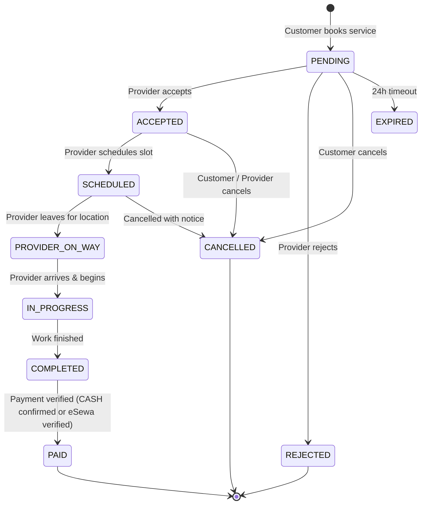

# SewaSathi — Business Rules & Domain Logic Specification
## Operational Policies, State Transitions & Settlement Invariants

---

## 1. Local Calendar & Schedule Conventions (Nepal)

1. **Standard Work Week:**
   - In Nepal, Sunday (`sunday`) through Friday (`friday`) are standard working days, while Saturday (`saturday`) is the standard public weekly holiday.
   - SewaSathi supports availability for all 7 days (`sunday`, `monday`, `tuesday`, `wednesday`, `thursday`, `friday`, `saturday`) as tradespeople frequently work on Saturdays.
2. **Standard Time Slot Definitions:**
   - `MORNING`: 08:00 AM – 12:00 PM NPT (Nepal Time, UTC+5:45).
   - `AFTERNOON`: 12:00 PM – 04:00 PM NPT.
   - `EVENING`: 04:00 PM – 08:00 PM NPT.
3. **Advance Notice Requirement:**
   - Appointments cannot be booked for past dates. Bookings must be requested for today's future slots or subsequent calendar dates.

---

## 2. Booking State Machine & Transition Rules

The lifecycle of every service appointment is strictly governed by a deterministic state transition matrix:

### 2.1 State Matrix & Invariants
- `PENDING`: Initial state upon creation.
- `ACCEPTED`: Provider has reviewed service requirements, customer location, and scheduled time.
- `REJECTED`: Provider cannot take the job; requires a reason (e.g., "Out of area", "Schedule conflict").
- `SCHEDULED`: Dispatch time confirmed.
- `PROVIDER_ON_WAY`: Provider has departed for the customer's residence. Cancellation disabled from this point forward.
- `IN_PROGRESS`: Physical repair or installation is actively being performed.
- `COMPLETED`: Physical service finished. Triggers settlement phase.
- `PAID`: Payment finalized either through eSewa HMAC verification or Provider Cash Collection Confirmation. Only `PAID` bookings unlock the Review submission action.

---

## 3. Financial Settlement & Payment Rules

### 3.1 Cash on Delivery (COD) Flow
1. Customer selects `CASH` during or after booking completion.
2. The system generates a `PENDING` payment record locked to the booking.
3. Upon physical service completion (`COMPLETED`), the customer hands cash to the technician.
4. **Mandatory Dual-Check Acknowledgment:**
   - The provider clicks **"Confirm Cash Received"** on their mobile app (or admin clicks confirmation).
   - The API verifies that the acting user is the assigned provider or admin.
   - The payment status transitions to `COMPLETED`, recording `collectedAt` and `confirmedBy`.
   - The booking status automatically advances to `PAID`.

### 3.2 Digital eSewa Settlement
1. Customer selects `ESEWA`.
2. Server computes `total_amount = basePrice * quantity` and creates an HMAC-SHA256 signature using the merchant secret key.
3. Client navigates to eSewa checkout or initiates verification.
4. eSewa notifies the server with the signed transaction token.
5. Server sends a background verification query to eSewa's verification endpoint.
6. Upon validation, the payment transitions to `COMPLETED` and booking advances to `PAID`.
7. Duplicate payments for the same booking are strictly rejected at the database level (`unique: true` index on `booking`).

---

## 4. Review & Reputation Moderation Rules

1. **Eligibility Enforcement:**
   - A review can ONLY be submitted by the customer who created the booking.
   - The booking MUST have reached both `COMPLETED` and `PAID` states.
   - Exactly ONE review per booking is permitted. Subsequent attempts yield `400 DUPLICATE_REVIEW`.
2. **Automatic Statistical Recalculation:**
   - Upon review submission, Mongoose hooks automatically compute the aggregate of all unmoderated reviews for that provider:
     $$\text{Average Rating} = \frac{\sum \text{Ratings}}{\text{Total Reviews}}$$
   - `provider.stats.averageRating` and `provider.stats.totalReviews` are atomically updated in MongoDB.
3. **Content Moderation:**
   - Platform administrators can flag or hide inappropriate or defamatory reviews (`isModerated = true`).
   - Moderated reviews are excluded from public search and provider statistical averages.

---

## 5. Provider Verification & KYC Invariants

1. **New Registrations:**
   - Provider accounts start with `verificationStatus = 'UNVERIFIED'`.
   - After uploading business documents (Citizenship Card, PAN, or Trade Certificate), status changes to `PENDING_REVIEW`.
2. **Discovery Gate:**
   - Only providers with `verificationStatus = 'VERIFIED'` and `user.status = 'ACTIVE'` are returned in public searches, geospatial queries, or category listings.
3. **Sanctions:**
   - In case of serious complaints or safety infractions, administrators can update status to `SUSPENDED` or `REJECTED`, instantly terminating active listings and rejecting new inbound bookings.
