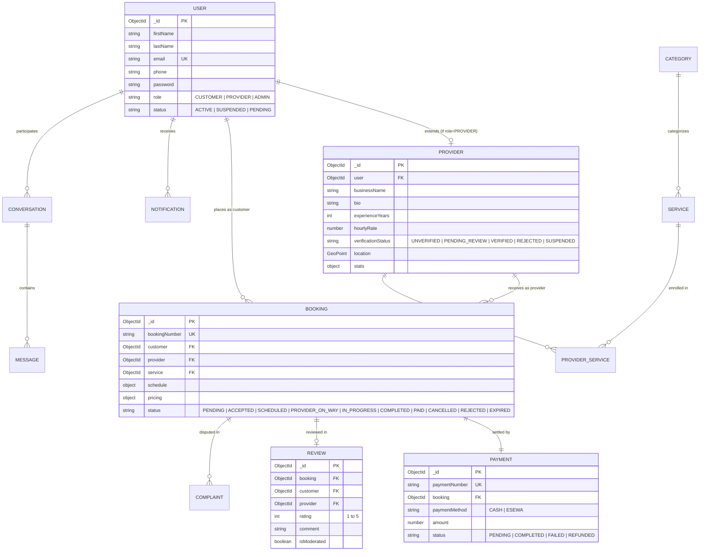

# SewaSathi — Database Design & Data Modeling Specification
## MongoDB Schema Architecture, Relationships & Indexing Strategy

---

## 1. Entity-Relationship (ER) Overview

SewaSathi utilizes MongoDB's flexible document model augmented with strict Mongoose schema validation and relational cross-references via ObjectIds:

---

## 2. Core Collections & Schema Definitions

### 2.1 Users Collection (`users`)
Stores platform identity credentials for all system participants.
- `firstName`: String, required, trimmed.
- `lastName`: String, required, trimmed.
- `email`: String, required, unique, lowercase, trimmed.
- `phone`: String, optional, validated against Nepal phone regex (`^\+977[0-9]{10}$|^98[0-9]{8}$|^97[0-9]{8}$`).
- `password`: String, required, hashed with bcrypt (never returned in JSON responses).
- `role`: Enum: `['CUSTOMER', 'PROVIDER', 'ADMIN']`, default: `'CUSTOMER'`.
- `status`: Enum: `['ACTIVE', 'INACTIVE', 'SUSPENDED']`, default: `'ACTIVE'`.
- `refreshToken`: String, optional, encrypted/hashed.

### 2.2 Providers Collection (`providers`)
Stores business credentials, KYC documents, and discovery attributes.
- `user`: ObjectId, ref: `'User'`, required, unique.
- `businessName`: String, required, trimmed.
- `bio`: String, optional, max 500 chars.
- `experienceYears`: Number, min 0, max 50.
- `hourlyRate`: Number, min 0, standard pricing guideline in NPR.
- `address`: Embedded subdocument:
  - `street`: String
  - `locality`: String (e.g., "Koteshwor", "Patan", "Baneshwor")
  - `city`: String (e.g., "Kathmandu", "Lalitpur", "Pokhara")
  - `district`: String
  - `province`: String
- `location`: GeoJSON Point schema (`{ type: "Point", coordinates: [longitude, latitude] }`) with 2dsphere index.
- `serviceAreas`: Array of locality strings.
- `verificationStatus`: Enum: `['UNVERIFIED', 'PENDING_REVIEW', 'VERIFIED', 'REJECTED', 'SUSPENDED']`.
- `kycDocuments`: Embedded subdocument (citizenship, PAN, trade certificate links).
- `availability`: Daily scheduling matrix (Sunday through Saturday) specifying active status and slot ranges.
- `stats`: Aggregated summary:
  - `averageRating`: Number, default 5.0.
  - `totalReviews`: Number, default 0.
  - `completedJobs`: Number, default 0.

### 2.3 Categories & Services (`categories`, `services`, `providerservices`)
- **Category:** `name`, `slug` (unique), `description`, `icon`, `isActive`.
- **Service:** `category` (FK), `name`, `slug` (unique), `description`, `basePrice`, `estimatedDurationMinutes`, `isActive`.
- **ProviderService:** `provider` (FK), `service` (FK), `price` (provider custom rate), `isActive`. Compound unique index on `{ provider: 1, service: 1 }`.

### 2.4 Bookings Collection (`bookings`)
Orchestrates the service appointment and state lifecycle.
- `bookingNumber`: String, unique (e.g., `BK-20261017-0001`).
- `customer`: ObjectId, ref: `'User'`, required.
- `provider`: ObjectId, ref: `'Provider'`, required.
- `service`: ObjectId, ref: `'Service'`, required.
- `address`: Embedded physical address snapshot where service will be rendered.
- `schedule`: Embedded appointment details:
  - `date`: Date, required.
  - `timeSlot`: Enum: `['MORNING', 'AFTERNOON', 'EVENING']`.
- `pricing`: Financial snapshot at time of booking:
  - `basePrice`: Number.
  - `quantity`: Number.
  - `totalAmount`: Number.
- `status`: Enum: `['PENDING', 'ACCEPTED', 'SCHEDULED', 'PROVIDER_ON_WAY', 'IN_PROGRESS', 'COMPLETED', 'PAID', 'CANCELLED', 'REJECTED', 'EXPIRED']`.
- `timeline`: Array of status change events with actor and timestamp.

### 2.5 Payments Collection (`payments`)
Tracks monetary settlements and escrow confirmations.
- `paymentNumber`: String, unique (e.g., `PAY-20261017-0001`).
- `booking`: ObjectId, ref: `'Booking'`, required, unique.
- `customer`: ObjectId, ref: `'User'`, required.
- `provider`: ObjectId, ref: `'Provider'`, required.
- `amount`: Number, required, must equal booking total amount.
- `paymentMethod`: Enum: `['CASH', 'ESEWA']`.
- `status`: Enum: `['PENDING', 'COMPLETED', 'FAILED', 'REFUNDED']`.
- `gatewayData`: Embedded eSewa transaction details (`transactionId`, `productCode`, `signedSignature`).
- `cashDetails`: Embedded cash handoff audit:
  - `collectedAt`: Date.
  - `confirmedBy`: ObjectId, ref: `'User'` (provider or admin).

### 2.6 Reviews Collection (`reviews`)
Maintains customer ratings and feedback.
- `booking`: ObjectId, ref: `'Booking'`, required, unique.
- `customer`: ObjectId, ref: `'User'`, required.
- `provider`: ObjectId, ref: `'Provider'`, required.
- `rating`: Number, integer from 1 to 5.
- `comment`: String, max 500 chars.
- `isModerated`: Boolean, default `false`.

### 2.7 Complaints Collection (`complaints`)
Handles dispute management and grievances.
- `complaintNumber`: String, unique.
- `reporter`: ObjectId, ref: `'User'`, required.
- `targetType`: Enum: `['BOOKING', 'PROVIDER', 'CUSTOMER']`.
- `targetId`: ObjectId, required.
- `category`: Enum: `['POOR_SERVICE', 'UNPROFESSIONAL_BEHAVIOR', 'OVERCHARGING', 'NO_SHOW', 'SAFETY_CONCERN', 'OTHER']`.
- `description`: String, required.
- `status`: Enum: `['OPEN', 'IN_REVIEW', 'RESOLVED', 'DISMISSED']`.
- `resolutionNotes`: String.

---

## 3. Database Indexing Strategy

To guarantee high-throughput query performance, the following indexes are actively enforced:

| Collection | Indexed Field(s) | Index Type | Purpose |
|---|---|---|---|
| `users` | `email` | Unique Single | Fast authentication lookups & duplicate prevention |
| `providers` | `user` | Unique Single | Fast 1-to-1 relationship resolution |
| `providers` | `location` | 2dsphere | Geospatial proximity search (`$nearSphere`) |
| `providers` | `verificationStatus, stats.averageRating` | Compound | Fast discovery sorting for verified providers |
| `providerServices` | `provider, service` | Unique Compound | Prevents duplicate service enrollment per provider |
| `bookings` | `bookingNumber` | Unique Single | Fast direct lookup |
| `bookings` | `customer, status` | Compound | Customer booking history queries |
| `bookings` | `provider, status` | Compound | Provider dispatch queue queries |
| `payments` | `booking` | Unique Single | Strict 1-to-1 payment constraint per booking |
| `reviews` | `booking` | Unique Single | Enforces maximum 1 review per service order |
| `reviews` | `provider, isModerated` | Compound | Fast public rating list retrieval |
